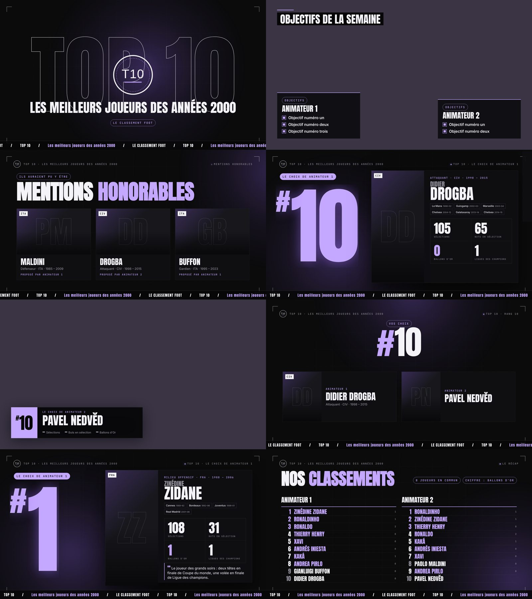

# TOPSIDE — studio des écrans Top 10

Deux écrans, dans le style de l'émission (ardoise noire, papier, scotch et surligneur lila, photos polaroid) :

1. **La carte joueur** : elle s'affiche par-dessus la caméra plein cadre pendant que vous présentez votre choix. On y voit le rang, la photo, le nom, le poste, la nationalité, les clubs, 4 stats et votre argument, avec le tampon « Choix de… ».
2. **Le récap** : les deux classements côte à côte à la fin. Les joueurs présents dans les deux tops sont surlignés.



## Remplir son top 10

Ouvrez le studio (`index.html`, ou la page en ligne).

1. **Réglages** : vos prénoms, le côté de la carte (gauche ou droite), le fond (caméra ou fond vert).
2. **Les 4 stats** : écrivez ce que vous voulez afficher (« Matchs », « Matchs capitaine », « Trophées »…). Cochez celle à surligner en lila.
3. **Votre top** : cliquez sur l'onglet de votre prénom, puis pour chaque rang tapez le nom du joueur et choisissez-le dans la liste. La photo, le poste et les clubs arrivent tout seuls. Remplissez vos chiffres et, si vous voulez, un argument.
   - Joueur absent de la liste : écrivez son nom quand même, puis ajoutez une photo avec « Photo perso ».
   - « Cacher ce top » floute votre liste, pour que l'autre ne la voie pas.

Tout est enregistré **dans votre navigateur, sur votre appareil**. Rien n'est envoyé ailleurs. Pour passer sur un autre ordinateur, utilisez « Télécharger la sauvegarde » puis « Ouvrir une sauvegarde ».

## Mettre la carte dans la vidéo

**Le plus simple : enregistrer l'écran avec le fond vert.**
1. Dans Réglages, choisissez **Fond vert**.
2. Cliquez **Plein écran**, lancez votre enregistrement d'écran, puis cliquez sur l'image pour rejouer l'animation. Les flèches ← → passent au joueur suivant.
3. Au montage (CapCut, Premiere, Final Cut…), posez l'enregistrement au-dessus de votre caméra et appliquez **Incrustation chromatique** (chroma key) sur le vert.

**En clips vidéo transparents** (pour quelqu'un à l'aise avec un terminal) :

```bash
node tools/export.js topside-sauvegarde.json
```

Ça crée dans `export/` un `.mov` transparent par carte et un `.mp4` du récap. Il faut Node.js, Playwright et ffmpeg.

## Banque de joueurs

Plusieurs centaines de joueurs sont déjà importés depuis Transfermarkt : photo, poste, nationalité, date de naissance, clubs, sélections et buts en sélection. Pour en ajouter (il faut Node.js 18 ou plus récent) :

```bash
node tools/transfermarkt.js "Nom du joueur" "Autre joueur"
```

Si la recherche tombe sur un homonyme, donnez le lien du profil Transfermarkt à la place du nom. Transfermarkt bloque si on enchaîne trop vite : l'outil attend 4 secondes entre deux joueurs.

## Changer le logo, le nom, les couleurs

- Nom de l'émission, logo et réseaux : `da/marque.js`. Le logo est le fichier `assets/logo.png`.
- Couleurs et typos : `da/kit.css` (`--lila`, `--papier`, `--ardoise`…).

## Fichiers

```
top10/
  index.html                     le studio
  scene.html                     l'écran 1920×1080 (affiché dans le studio)
  da/                            charte : couleurs, typos, animations, logo
  js/kit.js                      dessin des deux écrans
  data/joueurs.js                fiches saisies à la main (prioritaires)
  data/joueurs-transfermarkt.js  fiches importées
  data/demo.js                   l'exemple du premier lancement
  assets/joueurs/                photos
  tools/transfermarkt.js         import Transfermarkt
  tools/export.js                export vidéo
```

Polices embarquées : Anton, Permanent Marker, Inter et JetBrains Mono (licences libres, dans `fonts/`).

## Overlays de live (OBS)

Version épurée : fond sombre uni, cadres fins, logo, typo Anton et une touche de lila. Une seule caméra pour vous deux.

Ouvrez `live/index.html` : réglez le sujet, l'heure de début, le prochain live, puis copiez le lien de chaque écran dans une source **Navigateur** d'OBS (1920×1080, tout en haut de la liste des sources).

- **Le live commence** : compte à rebours, sujet du jour, tchat.
- **Réaction vidéo** : grand cadre pour la vidéo, caméra, tchat.
- **Réaction tweets** : cadre pour les tweets, grande caméra, tchat.
- **Tier list** : tableau interactif (clic droit sur la source → Interagir) avec les joueurs de la banque.
- **Discussion** : caméra plein cadre avec le sujet et le tchat.
- **Pause** et **Fin du live**.

### Alertes Twitch, derniers events, tchat (StreamElements)

Dossier `live/streamelements/` : trois widgets à coller dans des « Custom widget » StreamElements (onglets HTML, CSS, JS, Fields) :

- `alertes/` : follows, subs (dont offerts et réabonnements), bits, raids, dons. Une alerte à la fois, durée, son et logo réglables.
- `evenements/` : la ligne « Follow · Sub · Bits » avec les derniers noms.
- `tchat/` : le tchat Twitch dans la DA (bots et commandes masqués).

`live/streamelements/test.html` montre le tout en action avec de faux événements.

### OBS en un clic (Windows)

1. Dossier dans `C:\TOPSIDE`.
2. OBS → Collection de scènes → Importer → `C:\TOPSIDE\obs\TOPSIDE-scenes.json`.
3. Choisir la webcam dans « Caméra », la fenêtre du navigateur dans « Vidéo à regarder », puis sur un overlay : Interagir → double-clic → nom de la chaîne Twitch et sujet.

Le tchat (`live/tchat.html`) et les alertes subs / bits / raids (`live/alertes.html`) lisent directement le tchat public de la chaîne : aucun compte à brancher. Seuls les follows demandent StreamElements.

### Tout modifier soi-même dans OBS

Clic droit sur un overlay → **Interagir** → **double-clic** :
- réglages : nom de l'émission, couleur, chaîne Twitch, sujet, heure ou compte à rebours en minutes, prochain live, réseaux, lignes de la tier list ;
- **Modifier la disposition et les textes de cet écran** : glisser les cadres, le logo, le bandeau ; coin en bas à droite pour la taille ; cliquer sur un texte pour le réécrire ; **Enregistrer** (ou « Disposition d'origine » pour revenir en arrière).

Si vous déplacez un cadre (caméra, vidéo, tchat), déplacez aussi la source correspondante dans OBS pour qu'elle tombe dedans.
